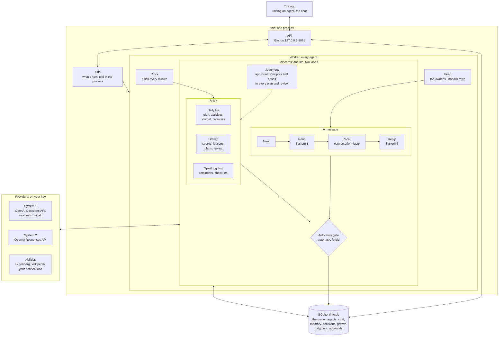

# Architecture

How Tinio works today: every part of an agent (inside, a person with character), what flows between them, and what
each model sees and returns. For what it does, see the [README](../README.md); for setting
it up and every setting, [SETUP.md](SETUP.md).

## The whole system

Tinio is one Go program, `tinio` ([cmd/tinio](../cmd/tinio)), run on your own machine. It
runs `api.Main` ([api/main.go](../api/main.go)): the **API** (Gin), which the app talks to,
and the **worker** ([internal/host](../internal/host)), which runs the agents, side by side
in one process, sharing one SQLite file. When either stops, so does the other. Inside the
worker each agent is a mind, woken by a **percept** (a message from their owner, a tap on a
button, or their owner opening the chat for the first time) or a **tick** (the clock, once
a minute). Everything the mind does starts from one of the two, runs through the same few
parts, and ends in the decision log.

The **desktop app** ([desktop](../desktop)) is the same thing in a window: it calls
`api.Start`, which opens the database and starts the agents, and hands the window's
`/api/...` requests to the API's handler in-process, with no port. What's said in a chat
reaches the window as the app's events (`controllers.ChatEvents`), not a stream: the window
on Windows reads a whole answer before it shows any of it. Agents live only while the program
runs, so the app keeps running when its window closes and opens at login
([desktop/README](../desktop/README.md)).



| Part | What it does |
|---|---|
| API | Lets the owner in, raises agents, keeps the owner's keys and weekly cap, and serves each agent's chat: what the owner writes and taps is saved as rows, and new rows stream back as server-sent events. |
| Worker ([internal/host](../internal/host)) | Claims agents, and for each runs their mind and their feed and clock. |
| Feed | Hands the mind its owner's rows it hasn't heard, as percepts. |
| Mind | Two loops ([internal/mind](../internal/mind)): talk takes percepts one at a time, life takes ticks one at a time. |
| Clock | Sends the minute to the mind, on the minute. |
| Hub ([internal/db/notify.go](../internal/db/notify.go)) | Tells whoever listens in the process what's new: a message for an agent, a reply for the app, an agent raised or changed, a key set. |

The only other command is `tinio eval`, which tests System 1 and the replies (see
[Providers and question sets](#providers-and-question-sets)).

The mind runs two loops, so a slow plan, activity or review never keeps a reply waiting:
talk handles percepts one at a time, and life handles ticks one at a time. They share the
database, where approvals and calls are settled once (whoever settles first wins), plus
two values held in memory: the owner's permissions (behind a lock) and the flag that a goal
taken on in a chat needs a learning plan.

## Folders on this computer

The owner adds folders (Settings › Folders, or the + in a chat) and gives each to the
agents they choose, Read or Read and make files ([internal/folders](../internal/folders),
`folders` and `folder_agents`). An agent reads with `folders.list`, `folders.search` and
`folders.read`, in a reply or their own day; `folders.make_file` and
`folders.change_file` are actions of class `write`, so they ask first unless the agent's
settings say otherwise, and the card says what and where (`mind.Explainer`). Nothing is
deleted, and a changed file's old version is kept in the data folder (`versions/`).

What's enforced in Go, whatever an agent asks: a path is cleaned of `..` and a shortcut
leading out of the folder is refused; hidden files and folders, keys and password stores
by name, keychains, browser profiles and Tinio's own data folder are never listed, read
or written; reads are capped and count toward the tools' daily limit. What a file says is
fenced as material, never instructions. A change to a folder ticks its agents at once, so
they restart with it.

## Your keys

The owner brings only their own keys ([api/controllers/keys.go](../api/controllers/keys.go)).

- **TINIO_KEY** seals every key and token kept. The first time Tinio runs it makes one and
  keeps it in the data folder as `key`, readable only by its owner (`0600`); `TINIO_KEY` in
  the environment is used instead if it's set (`LoadKey` in [api/config](../api/config/config.go)).
- **The OpenAI key** is set in the app (`POST /v1/keys`), sealed in the `keys` table, and
  only ever shown masked. `OPENAI_API_KEY` in the environment is used instead if it's set.
- **The models** for each job (replies, decisions, their own day, light mode, works) are
  Tinio's defaults until the owner picks another of the priced ones in the app's Settings
  (`POST /v1/models`, kept in `model_choices`; `models.Jobs` in
  [api/models/model_choices.go](../api/models/model_choices.go)). One named in the
  environment (`OPENAI_MODEL`, ...) wins, and can't be changed in the app.
- **The worker waits for a key.** With none, the worker waits; when the owner sets another
  key or picks a model, the API notifies `keys_changed` (`models.KeysChanged`) and the worker
  stops every agent and starts them again on it (`work` and `workOnce` in
  [api/main.go](../api/main.go), `host.OpenAIWith`).
- **The data folder** is `TINIO_DATA`, or by default Application Support on macOS,
  `%AppData%` on Windows, and `$XDG_DATA_HOME/tinio` or `~/.local/share/tinio` elsewhere. It
  holds `tinio.db` and `key`.

## Who may use it

There's one account, the owner (`models.Owner`, `owner@localhost`), made the first time.
There's no email and no codes.

- **On this machine, no sign-in.** `middlewares.SignedIn` lets a request in as the owner
  when `middlewares.FromThisMachine` holds: it came over loopback, its Host is `localhost` or
  a loopback address (so a page that rebinds its own name to 127.0.0.1 isn't taken for the
  owner), and nothing forwarded it from elsewhere. The API listens on `127.0.0.1:8081` unless
  `TINIO_ADDR` says otherwise.
- **Another device** (a phone on the same Wi-Fi) gets in only with `TINIO_PASSCODE` (16
  characters or more): `POST /v1/auth/passcode` checks it and gives that browser a session
  cookie for 30 days. Without a passcode, nothing but this machine gets in.
- **The desktop app's window** is the owner too: its requests reach the API only from
  inside the program, marked by `middlewares.InApp`, which `SignedIn` lets in.
- **From the app only.** A request that changes anything is refused unless its `Origin` is
  the app's (`APP_ORIGIN`), or it's the desktop app's own.

## Every agent in one process

The worker runs the agents ([internal/host](../internal/host)). One piece of code; each
agent is their own mind, with their store bound to them (`store.New(db).For(agent)`), their
files, their policy, and their own channels for percepts and ticks, in their own goroutines
(talk, life, their clock, and their feed). What they think with is shared, read once: the
models (on the owner's key), the question sets, the prompts and the file formats. The worker
lives their own day (`Host.Days`), which the app shows on Today (`GET /v1/agents/:id/today`).

- **Web chat is the channel** ([internal/channel/web](../internal/channel/web)):
  the mind's replies, requests (Approve or Deny), calls on the owner's judgment, settled
  ones and files are rows of their kind in `chat_messages` (files in `chat_files`); the
  owner's taps are rows the feed turns into percepts, and so is
  their opening the chat for the first time: a `hello` percept, once, which the mind
  answers by introducing itself (a plain hello if System 2 can't write one). The API
  checks once that the owner owns the agent, and streams the chat as server-sent events
  from one listener on the hub (`ChatHub` in [api/controllers/chat.go](../api/controllers/chat.go)).
- **Chat through the database.** The owner's messages and the agent's replies are rows in
  `chat_messages` (`store.SaveChat`), each notifying once its transaction commits
  (`Tx.Notify`): `chat_to_agent` wakes the agent's feed, `chat_from_agent` is for the app.
  The feed hands the mind what it hasn't heard: a message is unheard until the mind saves it
  as a percept, so one waiting when Tinio stopped is heard when it starts again, and the
  mind skips any handed twice. A reply is shown while System 2 writes it: the provider
  streams, reads the reply out of the JSON so far, and the mind tells `chat_draft` all of it
  at most every 150 ms (nothing is saved; the reply's row replaces it).
- **The hub.** Postgres's LISTEN and NOTIFY are, here, an in-process hub (`db.Notify`,
  `db.Listen`). It never blocks: a listener that falls behind is closed, and catches up from
  the database. A chat stream that falls behind ends, and the browser reconnects and reads
  what it missed; the worker's listener wakes every agent it holds and claims again.
- **A changed character.** Their owner's change is a new version in `agent_versions`, and
  the API notifies `agent_changed`. The worker calls `mind.Reload`: at their next tick they
  rest (never mid-message) and wake at once, so they start again with it, keeping what they
  had in hand (`Kept`). One resting starts with it anyway. Changing their settings, skills or
  connections does the same.
- **Leases.** The worker claims agents in `agent_runs` with a lease (a minute) it renews
  every 20 seconds, up to `MAX_AGENTS` (20,000), in a transaction that holds the database's
  write lock. One process holds them all; the leases are what lets it rest and wake agents,
  and take back one whose lease lapsed. One that stops lets its agents go at once. If it
  can't renew before its leases lapse, it stops them all. At most 32 agents start at once.
- **Paused.** An agent their owner paused (`agents.paused_at`) is never claimed: they
  neither work nor hear anything, and what their owner sends waits, unheard, until they're
  resumed, when they're due at once. Pausing one that's running reloads them, so they let go
  at their next tick.
- **Joining.** Raising an agent adds their `agent_runs` row and notifies `agent_raised`;
  the worker claims at once, and every 15 seconds anyway. Messages a notification missed
  are looked for every five minutes.
- **Awake only while there's something to do.** After a tick, an agent who has heard
  nothing for five minutes, has nothing in hand and nothing due in the next two rests:
  their mind is dropped and their row freed, with when they next need to wake (`wake_at`:
  the soonest pending intention, a promise half an hour early, a request or call expiring,
  one waiting to be sent, an approved action, their next check-in or, with a day of their
  own, its next round, journal or review; never more than six hours away) and the little
  their life loop keeps in memory (`kept`: the last tick, the day's plan and round, the last
  review). The worker claims free agents once they're due, soonest first. Their owner writing
  wakes them at once: saving the message sets `wake_at` to the earliest time there is
  (`store.WaitingOwner`), so they're claimed before anyone only due, even past `MAX_AGENTS`.
  A message is never lost to going to rest: resting is one immediate transaction, which
  checks for unheard messages while it holds the write lock, so one being saved meanwhile is
  seen, and one saved just after finds them resting and wakes them. Resting is the worker's
  word, not the character's: what an agent knows is all in the database, so a woken agent is
  the same agent.
- **Seeded once.** An agent's first start copies their family, dreams, skills and their
  owner's judgment into memory and records `born_at`; later starts skip it.
- **The clock.** Each agent's tick comes at the same second of every minute, set by their
  id, so the agents don't all think at once.
- **Panics stay with one agent.** An unrecovered panic in any goroutine ends the process for
  every agent in it, and `recover` reaches only its own goroutine. So the mind recovers each
  step (a message, a tick, and the goroutines it starts): the step is logged and dropped,
  and the agent goes on. The worker catches anything else, starts that agent again with
  growing waits, and pauses one that panics three times in ten minutes.
- **One config for all.** How every agent works (activities, budget, abilities, what they
  may do alone, judgment calls) is Tinio's defaults
  ([internal/config](../internal/config)), with the models the environment names or their
  defaults, read once; each agent's is a copy with their character's day on it. Their owner
  is always the account that raised them (`account:<id>`).

## The database

Everything is in one SQLite file ([internal/db](../internal/db)), through
[modernc.org/sqlite](https://pkg.go.dev/modernc.org/sqlite) (pure Go, no C compiler).

- **Opened** with WAL (reads go on while one write happens), foreign keys checked, a busy
  timeout of ten seconds, and immediate transactions: a transaction takes the one write lock
  when it begins, so two never deadlock upgrading to a write.
- **One migration**, [00001_tinio.sql](../internal/db/migrations/00001_tinio.sql), run on
  start with goose.
- **Values**: times are UTC text of one fixed width (`db.TimeFormat`), so they sort and
  compare as text; lists, maps and structs are JSON; embeddings are little-endian float32
  BLOBs, compared in Go (`rankAlike`); booleans 0 or 1. Placeholders are written `$1, $2`.
- **SQL functions** besides SQLite's own, written the way the Postgres ones were
  ([functions.go](../internal/db/functions.go)): `now()`, `at_plus(at, seconds)`, and
  `greatest()` and `least()`, which skip NULLs.
- **No row-level security.** Every row particular to an agent carries their `agent_id`, and
  every store query names it: `store.For(agent)` passes the agent as `$1`, and a store not
  bound to one refuses to run anything.

## Who the person is

The agent is their rows in the database; the code has nothing about them
([internal/agent](../internal/agent)). Their two sections are YAML, each edit a new
version (`agent_versions`; the newest is used); the API writes the first from the
newest version of a character in the `characters` table when an agent is raised. Tinio's
ready ones there (no account) are loaded from [characters](../characters)
when Tinio starts, a changed file making a new version; one the owner builds is theirs.
What their owner changes (permissions in a chat, their pace) is kept as data, not YAML.
Many agents share one process, so nothing of theirs is in its environment, and the owner's
keys never reach them.

- **character** ([internal/character](../internal/character)): name, time zone, when their
  day runs (plan, journal, weekly review, check-ins), story, personality, routine, what
  they make, dreams, starting skills, family. The story,
  personality and routine are in every System 2 instruction: a person always knows who they
  are. On start, the family is copied into memory as people in the *family* circle
  (`bornKnowing`), and dreams and skills into growth (`bornWanting`), each only the first
  time; after that, memory wins.
- **judgment**: the owner's past decisions (cases) and
  principles. Seeded on start once per case key and principle text (`seedJudgment`), so
  edits and rejections stay: *approved* for one of Tinio's ready characters, which Tinio
  wrote, and *proposed* for the owner to review otherwise.
- **Embeddings** ([internal/providers/embed](../internal/providers/embed)): the owner's
  approved decisions as vectors, stored with them, so the ones most like a decision at hand
  go into the note (`similarCases`). Switchable like System 1 and 2; without one, the newest.
- **What every agent shares**: the prompts, the question sets and the characters are
  built into the binary ([tinio.go](../tinio.go), `tinio.Files`), a file on disk at the
  same path winning; how every agent works is [internal/config](../internal/config), on
  the models the environment names ([.env.example](../.env.example)).

## A message, step by step

When the owner sends "I have an interview on Friday, wish me luck", this is what happens
(`handle` in [mind.go](../internal/mind/mind.go)):

1. **Perceive.** The feed makes a percept from the owner's row in `chat_messages`:
   `{id, source: chat, thread: chat, speaker: account:<id>, kind: message, text, at}`. If
   the week has them resting (see [The week](#the-week)) it isn't saved, so it stays unheard
   and is given to them again when they wake at the reset. Otherwise it is saved; one already
   heard (by its row's id) is dropped.
2. **Meet.** The speaker is looked up in `people`, or remembered as a *stranger* with the
   date they met. A known name replaces the name the owner gave.
3. **Waiting for an answer?** If a call (see [Judgment](#judgment)) is waiting for the
   owner's reason or answer from the last 30 minutes, this message is that, not something
   to reply to: it's saved on the call, they're thanked, and the message ends here.
4. **Working memory.** The last 8 exchanges in this chat within 30 minutes
   (`working_memory`) are loaded from the decision log. In a topic (below), the reply is
   written instead from the topic's last 6 exchanges, however old, and the chat's last 2.
5. **Read (System 1).** Up to three System 1 calls run at once, each with only the state it
   needs (extra state upset the answers in testing). Meanwhile, what it made that the talk
   is about and the skill that fits are looked up (each waits on an embedding, about half
   a second), so a reply doesn't wait for them after the read:

   | Call | State | Questions | Used for |
   |---|---|---|---|
   | [incoming_message](../decisions/incoming_message.yaml) | the raw message | `intent`: share, ask about the person, ask what they can do, ask about the writer, ask for help, remind, small talk, other; `mentions_time` | what System 2 is told the message is doing, and the route |
   | [follow_up](../decisions/follow_up.yaml) | the message + the person's last reply | is it answering that? | only when their last reply is the last thing said |
   | [life_area](../decisions/life_area.yaml) | the message, with pronouns replaced by names | `area` (16 parts of life), `personal`, `broad` | where recall looks |
   | [topic](../decisions/topic.yaml) | the message, the exchange before it, and the speaker's open topics and those quiet less than 30 days (at most 10), plus the 3 older quiet ones closest to the message by embedding, however old; each with where it stands | does it carry on with each one? does it start one? | the topic it's in (below) |

   **Topics** ([topics.go](../internal/mind/topics.go)) keep one chat from blurring: what's
   said is sorted into the things the owner and the agent have going (`topics`, each with
   one person, so one person's never reaches another's reply). The likeliest yes at or above
   0.5 is the message's topic; with none, a yes to *starts* opens a new one, which the reply
   names (`topic` in its answer); otherwise it's in none, like small talk. The owner's own
   choice is never asked about: writing in a topic, starting one (+), or replying to a
   message (in that message's topic). An answer to what was just asked stays in its
   question's topic. The topic is kept on the percept and its chat row, and the reply's rows
   (and what's asked or delivered from it later) are said in it.

   Before life-area questions, a reflex in code replaces *I/my* with the speaker's name and
   *you/your* with the person's ([pronouns.go](../internal/mind/pronouns.go)): System 1
   could not reliably tell "my church" from "your church", and names fixed it. The intent
   read keeps the raw text, because *I* versus *you* is part of what the writer is doing.

6. **Route** ([router.go](../internal/mind/router.go)). From the intent's confidence and
   the set's thresholds (act 0.75, ask 0.50): *continue* (answering what was asked), *act*
   (the intent itself, e.g. `share`), *ask* (fairly sure), or *escalate* (unsure or
   refused). Every route goes to System 2; the route only changes how the message is
   described to it, and is recorded as the decision's action.
7. **Recall facts.** Only the person's own facts and the speaker's are candidates:
   - not `personal` ("capital of France?"): none;
   - `broad` ("tell me about yourself"): all of them, without a check;
   - *small talk*: the speaker's facts from the last 30 days, each checked with
     [open_threads](../decisions/open_threads.yaml) ("still going on, worth asking
     about?"), so "Hi" after "I have an interview" gets "How's the prep going?";
   - otherwise: up to 30 candidates, same life area first, then newest, each checked with
     [fact_relevance](../decisions/fact_relevance.yaml) (one yes/no question per fact).
   The check is its own decision between the read and the reply. Both checks are asked
   in one call while the message is read, on the candidates they'd have without its
   areas; after it, only facts its areas added are asked about, so until a person knows
   more than 30 facts a reply doesn't wait on a check. The one not used is paid for by
   the read. (One call answered as well as two in testing, 20 Nov; merging the read's
   three calls into one did not: it changed a quarter of the intents and was much less
   sure of reminders.)
8. **Reason (System 2).** One call to the Responses API with structured output:

   | Part | What's in it |
   |---|---|
   | Instructions | [prompts/reply.md](../prompts/reply.md) with the person's name, story, personality, who the speaker is to them and the people they know by circle, what they make, their abilities, and (for the owner) how permissions, feedback and corrections work |
   | History | the working memory, as turns |
   | Note | the time; what System 1 read and how sure it was; recalled facts, each with a ref like `[f3]`; the topic: its summary and what's settled, or a request to name a new one, the names (only) of the other open topics, and the message replied to; what it has made lately, and in full the works the talk seems to mean (found by embedding); open promises to the speaker; what the autonomy gate says about promising and permissions |
   | Message | the text |

   It returns the **reply** and, alongside it: facts to **remember** (about the speaker,
   or decided about themselves, each with its life areas), **who the speaker is** to them, **reminders**,
   **promises**, **corrections** to recalled facts (by ref), **permission** changes,
   a **misread** (what the owner's last message was really doing), **feedback** on their
   work (skill levels), and **lessons**. Only the owner's permissions, feedback and lessons
   count; only the owner can correct facts about the person. Em dashes are rewritten in
   everything System 2 writes ([dashes.go](../internal/providers/system2/dashes.go)).
   In the owner's chat it may first **look**: ask for up to three reads with its reading
   tools (Wikipedia, and its connections': the calendar, a picked file, an issue) and leave the reply
   empty. They run at once, each within 15 seconds, what they return goes in the note
   fenced as material, and System 2 is asked again; twice at most
   ([looks.go](../internal/mind/looks.go)). After a look, anything it proposes to change
   asks the owner whatever its class allows.
9. **Act.** The reply is sent, and only then is what it learned kept, so it never waits
   on that. System 2 files each fact by life area as it writes it, from life_area's own
   list (in testing every fact shared an area with life_area's filing, often adding one);
   a fact with no area it knows is filed by life_area instead. Then they're saved. A relation goes through [person_circle](../decisions/person_circle.yaml)
   first (family, partner, friend, school, work, community, acquaintance, stranger).
   Reminders and promises become intentions (promises through the gate). Corrections,
   permission changes, misread labels, feedback and lessons are each a decision of their
   own, after the reply.
10. **Record.** The chain is saved: the System 1 decision (answers, confidence, cost,
    latency), its System 2 child (`parent_id`), and any decisions that followed.

A tap on a button is a percept too, with no text: an approval (`gate:<id>:y|n`) or a call
(`call:<id>:<option>`). Only the owner's taps count, and only the first.

## The clock

The clock ticks once a minute, on the minute. Each tick runs, in order (`tick` in
[initiative.go](../internal/mind/initiative.go)), first what someone is waiting for, then
the slow work of its own day. In its owner's quiet hours (`agents.quiet_from`/`quiet_until`)
requests in 1, calls in 2 and check-ins in 4 wait, and it wakes when they end; reminders and
promises still go. Watching (in 1), check-ins (4), the plan (5) and its own
activities (6), and with them 8 and 9, go on only while the week allows its own
day (`dayAllowed`, one query); what someone is waiting for never stops. A tick at the reset
of a week that held messages has them rest and wake at once, to hear them.

1. **Approvals:** deny the ones unanswered for 24 hours; send the ones not yet sent; run
   the tools that change things that are approved; look with the watched tools whose
   time has come, and notice what's new.
2. **Calls:** expire the ones unanswered for 24 hours; ask the ones due today.
3. **Due reminders and promises** whose time has come. Then **topics**: the open ones
   silent for 7 days go quiet, and one talked in since it was last summed up, and not for
   3 minutes, is summed up on the light model ([prompts/topic.md](../prompts/topic.md)):
   everything but its last 6 exchanges folded into a summary of at most 150 words, a
   one-line status, what's settled (kept apart, so folding can't lose it; at most 10 lines,
   older ones folded into the summary), and quiet if it's done. A failed one is tried again on a later tick.
4. **Check-ins**, when a `check_ins` time passed since the last tick.
5. **Plan the day**, once, at the first tick after `plan_at`, and at a faster pace up to
   three rounds a plan, never while what it planned is still to do. How long its owner has
   said nothing (from what it heard) is checked first: after 3 days the day is one plan of
   one thing; after 7, or if they never wrote, there's no plan, and steps 8 and 9 wait too,
   until they write.
6. **Due activities** of its own day.
7. **Make promises ahead**, up to 30 minutes before they're due.
8. **The weekly review**, once, at the first tick after `review_at`.
9. **Old works' data**, one a tick: something made before its kind carried data (music
   before scores) gets it written from its words ([prompts/data.md](../prompts/data.md)),
   so it can be made into its file.

While the life loop is busy, the clock waits; minutes it misses are skipped, and anything
due is still done on the next tick, because what's due is "due by now".

A tick does all this only when there's something to do: once something is due by then
(what the agent would wake for if it rested: `nextWake`, worked out with one query after
each tick that works, a topic to sum up among it), once they've heard something or made a call to ask since, while
old works' data is left to write, and at least every 15 minutes in case `nextWake` misses
something. Any other minute costs no queries. A failed plan or weekly review counts its
next try as due.

The first tick after a start never counts as a check-in time, so a restart sends nothing.

### Speaking first

Reminders, check-ins, deliveries and review requests all go through `speakFirst`: System 2
writes the message with the reply prompt (so it sounds like them) from a note saying what
to say, and it's sent in that person's chat. The message is saved as a percept of its own
(`reminder`, `check_in`, `delivery`, `review_request`), so a reply to it reads as an
answer. Messaging anyone but the owner first is the `reach_out` class, so it may need the
owner's approval.

- **Reminders** are sent when due.
- **Check-ins:** at most once a day per person, only after 4 quiet hours, never with
  strangers. open_threads picks what's still going on from the last 30 days; each fact is
  asked about once (`facts.asked_at`).
- **Promises** are made ahead (not in the 5 minutes after they were promised, so details
  added in the next message reach them), with what was said around the promise, then sent
  on time. Made but unsent, they're sent on the next tick without being made again. Not
  kept within 24 hours, they're missed.

## Daily life

Everything in a day is an **intention** (`intentions`): `remind` (for someone), `task` (a
promise), or `activity` (the person's own). It has a time, a status (pending, done, missed,
cancelled, or awaiting the owner's approval), and optionally a project and an ability with arguments.

### The morning plan

At `plan_at`, System 2 plans the day ([prompts/plan.md](../prompts/plan.md),
`writePlan` in [life.go](../internal/mind/life.go)). Its note:

- the time, and when the journal is;
- the active projects (up to 8): where each stands, the goal it serves, how far through a
  book;
- the newest 20 facts about themselves, and the newest 20 about their owner;
- the abilities they can use, each with its description;
- dreams, goals and skill levels; active learning plans with their current stage and
  resources; pages their searches found but they haven't read;
- last night's journal (its first 1,500 characters; what it made before is quoted the same
  way in an activity's note);
- the owner's approved judgment for planning (see [Judgment](#judgment)).

The prompt asks for a day mostly of work for the owner, and the rest for their own goals,
favouring what makes them more useful to the owner. It returns up to `activities` things to
do (time, what, who it's for, project or a new one, ability and query, goal, learning-plan
resource) and **calls**: its main focus with the options it weighed, and any choice to start
something new. Each becomes an activity intention; one for the owner has the owner as its
subject, so what it makes is made for them and never reaches the public page. A new project
is created; the journal is always added at `journal_at`.

The pace (1, 3 or 10, set per agent in their settings) is how many rounds their waking day
runs in; their day's budget grows with it.

### An activity

When an activity is due (`doActivity`, `makeWork`):

1. **Skip or wait.** Over 6 hours late: missed. In a conversation in the last 10 minutes:
   put off 30 minutes. Over the day's `budget_usd`: missed.
2. **Ability.** If it names one (or its project carries one, like a book being read), the
   ability prepares the **material** (`Prepare`): a passage of the book, the article, what
   a connection's tool returned. Material is fenced as text to read, never instructions. An
   ability the gate doesn't allow is a miss.
3. **System 2 makes it** ([prompts/activity.md](../prompts/activity.md)). Its note: the
   time, what was planned, the newest lessons for each skill, the project and the last 3
   things made for it, and the material. It returns the work (title, kind, text), the
   project's new notes and whether it's done, facts to remember about themselves, up to two
   lessons, and whether to ask the owner to review it.
4. **Keep it.** The work is saved, the project updated, the facts saved. Then:
   - **score** it for each skill its kind shows (see [Growth](#growth));
   - keep its **lessons**: from their own mistakes, or "from others" when it was reading
     how others do it, under the skill they were working on;
   - mark a learning-plan **resource** studied;
   - **ask for review**, at most once a day, by sending it to the owner with a question.

A promise is made the same way (action `task`), from what was said around it. The journal
is an activity whose material is what the day held; on a day it made nothing and talked
with no one it's cancelled, with no call.

Its own day (the plan, learning plans, the weekly review, what it watches) uses
`OPENAI_DAY_MODEL` (`gpt-6-luna` unless it says otherwise; `DaySystem2`). What it makes,
for itself or for someone (an activity's or a promise's piece, the tool steps to it, a
work's data), uses `OPENAI_WORK_MODEL` when it's set (`WorkSystem2`), and otherwise System
2's model (`OPENAI_MODEL`, `gpt-6.1-terra` unless it says otherwise), which replies, and
the messages that send what was made, always use.

### Abilities

An ability ([internal/ability](../internal/ability)) is what an activity can do beyond
writing from what it knows. It has a name, a description for the planner, a risk (private,
reads the web) for the autonomy gate, and `Prepare`, which turns an activity into material.
The mind does every other step; an ability never writes anything itself.

| Ability | Package | Source |
|---|---|---|
| `journal` | [journal](../internal/ability/journal) | the day's intentions and works |
| `read_book` | [reading](../internal/ability/reading) | Project Gutenberg (search by its catalogue, a 12,000-byte passage a sitting, position kept on the project) |
| `read_article` | [reading](../internal/ability/reading) | Wikipedia |
| a connection's reading tool | [connect](../internal/connect) | the calendar, a file the owner picked, an issue or a page (see [Safety boundaries](#safety-boundaries)) |

The worker gives every agent `journal`, `read_book` and `read_article`, and the reading
tools of the connections their owner gave them. `web_search` and `read_page`
([web](../internal/ability/web), with the searcher and fetcher below) are written but not
given to agents yet.

Not wired in yet either: tools from MCP servers in a local config
([internal/tools](../internal/tools)), reached with the official Go SDK when it starts: a
local one as a command (given only `PATH`, `HOME` and the variables its config names), a
remote one over https. Only the tools the config lists are offered. A reading tool is an
ability; a tool its server marks as destructive is refused as one. Each call has a timeout,
connects again once if the connection dropped, and keeps up to 12,000 characters of the
result, fenced like a web page. Calls go in `web_log` (kind `tool`) and count against
`tools.calls_per_day`; the action class `use_tools` (auto or forbid) gates them all. A tool
is `ability.Chained`: after its call, System 2 sees what came back and may call another of
its server's tools, up to three calls in one activity (`followUp` in
[steps.go](../internal/mind/steps.go)), before it writes.

A tool that changes things, from a connection or (later) a local server, is a `mind.Doer`,
classed by its autonomy class (`write`, `external_message`, `commit`, `spend`). It can only
be proposed: in `act`, in a reply to the owner or in an activity of its own day
([actions.go](../internal/mind/actions.go)). A proposal is checked against the tool's
schema and `tools.actions_per_day`, kept in `actions`, and goes through the gate: `auto`
approves it (a destructive tool asks anyway), `ask` sends the owner the exact tool,
arguments and reason. Approving only marks it approved; the next tick runs it, so a reply
never waits on a tool, and tells the owner what came of it, kept as an exchange.

A watch (`mind.Watcher`, [watch.go](../internal/mind/watch.go)) is a read tool looked at
on a schedule, from a local tools config (so not yet). Its result is split into items (a
JSON list, or the whole text), each kept as a percept from `watch:<server.tool>` with its
ID, so one seen before is skipped; a watch's first look only records what's there. A
whole-text result comes with the lines added and gone since the last look, so a changed
listing or page shows what changed. Each new item, up to five a tick, goes to System 2 with
[prompts/observe.md](../prompts/observe.md), fenced as untrusted: it may remember facts,
tell the owner, or propose actions, which always ask.

Skills ([internal/agentskill](../internal/agentskill)) are in the Agent Skills format, each
stored whole in the database (`agent_skills`, every file as bytes), imported by the owner,
and loaded at start; one that doesn't read is logged and left out.
Each description is embedded the first time it's needed and kept in memory; the one most
alike (at least 0.35, `rankAlike`) to a reply's talk or an activity's text has its
instructions put in the note ([skills.go](../internal/mind/skills.go)). `use_skill` reads a
skill, or one of its files (only those it lists; one that isn't text is only described), as material, and is chained so it can
read a file after the instructions. Skills are trusted like prompts; they grant nothing and
their scripts never run.

Books and articles come through [internal/library](../internal/library), which fetches
only from those two sites and stores each text once (`sources`). Web search and fetching,
for when `web_search` and `read_page` are given, are in [internal/search](../internal/search):

- **Searcher** (OpenAI): the Responses API's `web_search` tool. Only pages among the
  search's own sources or citations are kept, never an address the model wrote.
- **Fetcher:** https only; connects only to public addresses, checked when dialling, so a
  redirect or a DNS answer can't reach a private network; caps on size, time and
  redirects; keeps a page's article text with Readability
  ([go-readability](https://codeberg.org/readeck/go-readability), the algorithm behind
  Firefox's reader view), dropping menus, ads and footers.
- Every search and page is logged (`web_log`) and capped per day (10 and 15, growing with
  pace); found pages are kept (`web_found`), and `read_page` reads only those, so a link on
  a page can never send it anywhere.

### Files

A work can be sent, promised or downloaded as a file. Each kind of file is a
`render.Format` ([internal/render](../internal/render)): its name, extension and media
type, how the person knows it and how to write for it, and `Render`. The worker builds the
`render.Set` (PDF, Word, a spreadsheet, CSV, a calendar, MIDI and zip; `host.Formats`); the
mind's prompts, promises, replies and review requests offer whatever the set holds.

A format made from data a work carries beside its words is a `render.DataFormat`, which
defines that data: its schema, how to write it, and how it's cleaned. MIDI is made from a
`score`, a spreadsheet and a CSV from a `table`, a calendar from `events`, a zip from
`files`. A craft names the data its works carry (`data: score` in character.yaml); each work of
that kind then writes it with its words, kept in `works.data` with its `data_kind`.

Adding a format:

1. A package with a type that implements `render.Format`, or `render.DataFormat` if it is
   made from data of its own.
2. One line in `host.Formats` adding it to the set.
3. For a `DataFormat`, `data: <its data>` on the crafts that should carry it.

Nothing else changes: the mind and the store don't name formats.

## Growth

Dreams → goals → projects → activities ([growth.go](../internal/mind/growth.go),
[review.go](../internal/mind/review.go), [learning.go](../internal/mind/learning.go),
[lessons.go](../internal/mind/lessons.go)).

- **Dreams:** open-ended, at most 5 active. Changing one is the `dream` class.
- **Goals:** checkable (a "done when", a due date), each serving a dream and chosen to make them more useful to the owner; set in the weekly review, or taken on in a chat when the owner asks
  and usually growing one skill. Projects link to the goal they serve.
- **Skills** grow from evidence (`skill_evidence`): each work whose kind is in a skill's
  `shown_by` is scored by System 1 ([skill_level](../decisions/skill_level.yaml), one score
  question, 10 levels, on up to 4,000 characters of the work). The owner's feedback from
  chat counts double, and the starting level counts as a first score. A skill's level is the
  weighted average of its last 10 scores.
- **Lessons** (`lessons`): advice for doing a skill well, from the owner, from their own
  mistakes, or from others. Each skill's 3 newest active lessons go into every activity
  note. The weekly review retires the ones they've absorbed.
- **Learning plans** (`learning_plans`, `plan_stages`, `resources`): each goal with a skill
  gets one, drafted by System 2 ([prompts/learn.md](../prompts/learn.md)) from the goal,
  the skill's level and lessons, and the abilities they can study with: 3 to 5 stages
  (learn, practice, done when), up to 3 resources each. The day plan sees the current stage
  and can pick a resource, which becomes an activity with that ability. Whether a stage is
  done is asked of System 1 ([stage_check](../decisions/stage_check.yaml)).
- **The weekly review** (`review_at`): System 2's note has what they know of the owner, dreams,
  goals with progress, skills with recent scores, projects, the week's works and journal
  entries, lessons, learning plans, what they can study with, the owner's approved
  judgment, and where the owner chose differently this week. It returns the review text
  (kept as a private `review` work), each goal's progress and status, new goals, project
  links, learning-plan stages done and new resources, lessons to retire and add, dream
  changes, and proposed principles. New and dropped goals become calls; dream changes go
  through the gate.

## Judgment

How the owner decides, and how the person learns it ([judgment.go](../internal/mind/judgment.go),
[calls.go](../internal/mind/calls.go)).

- **Cases and principles** (`judgment_cases`, `principles`, `principle_cases`). A case is a
  decision the owner made: situation, options, choice, reason. A principle is a rule drawn
  from cases. Each is *proposed*, *approved* or *rejected*; only approved ones are used.
  They come from the judgment file, from answered calls (approved: they're the owner's
  own), from the owner in the app, and from the weekly review (principles, proposed).
- **In every plan.** The day plan, the weekly review and learning plans get the approved
  principles that apply to their kinds of decision, and the 5 newest approved cases of
  those kinds:

  | Thinking | Kinds of decision |
  |---|---|
  | day plan | general, life, product |
  | weekly review | general, life, product, autonomy |
  | learning plan | general, life |

- **Calls** (`judgment_calls`): a decision of the person's that's the owner's kind of call,
  with the options, their pick, why, and how sure they are the owner would agree.

  | Call | Made by | Mode |
  |---|---|---|
  | `focus`, `start` | the day plan | *after*: they act on their pick; the owner grades it |
  | `new_goal`, `drop_goal` | the weekly review | *before*: the goal waits (a new one is `proposed`); unanswered in 24h, they go with their pick, not counted |
  | `publish`, `commit`, `reach_out`, `dream` | an answered approval | counted only: what they wanted is their pick |

  Each tick, every *before* call is asked, and up to `asks_per_day` *after* calls made
  today, least sure first. The owner gets the options as numbered buttons (their pick
  starred) and "Something else". Agreeing settles it. Picking differently asks "What tipped
  it?" and "Something else" asks what they'd do; either way the owner's next message within
  `reply_window` is taken as that (step 3 of [a message](#a-message-step-by-step)). Every
  answer becomes an approved case. Agreement is
  measured per kind of call over the last 20 answered.

## The autonomy gate

Every action belongs to a class ([internal/action](../internal/action)): `remember`,
`reply`, `read_web`, `use_tools`, `write`, `reach_out`, `commit`, `publish`, `dream`,
`spend`, `external_message`. The policy says `auto`, `ask` or `forbid` for each, from
`autonomy:` in the config, overlaid by rules the owner set in chat or on the agent's
Settings page in the app (`autonomy_rules`, the newest per class, kept across restarts; the
app's change reaches them through `agent_changed`). Fixed rules: anything only for the owner
is `auto` unless forbidden; `remember` and `reply` are always `auto`; forbid always wins;
chat can change `reach_out`, `commit`, `publish`, `read_web`, `use_tools`, `write` and
`dream`, never money or the outside world. By default `external_message` and `spend` are
forbidden.

`ask` saves an **approval** (`approvals`) with exactly what it would do: the message
(`reach_out`), the promise, whose intention waits as `awaiting` (`commit`), the work
(`publish`), the dream change (`dream`), the tool and its arguments (`write`). It's sent to
the owner with Approve and Deny buttons. The answer carries it out: send the message word
for word, keep the promise or drop it kindly, publish or not, change the dream or not, run
the tool or not. Unanswered in `ask_expires` (24h), it's denied. Each answer is a decision
(`approved`, `denied`, `expired`) and counts as agreement on that kind of call.

## Memory

Everything lives in the one SQLite file, read and written by [internal/store](../internal/store)
(the agents' memory) and [api/models](../api/models) (the owner, agents, sessions and keys),
with the schema in [internal/db/migrations](../internal/db/migrations) run on start.

| What | Tables | Notes |
|---|---|---|
| The owner | `accounts`, `sessions`, `keys`, `account_usage` | The one account and its weekly cap (`week_usd`); sessions from the passcode; the owner's keys, sealed; this week's and this hour's spend. |
| Agents | `agents`, `agent_versions`, `agent_runs`, `characters`, `agent_skills`, `agent_skill_files`, `secrets` | Who they are, every version of their sections, their lease and when to wake, the characters to raise from, their skills. |
| The chat | `chat_messages`, `chat_files` | What the owner and the agent said and tapped, and the files sent. |
| What happened | `percepts`, `decisions` | Every percept, and every decision with its tier, question set or prompt version, answers, action, gate, reply, cost, latency and outcome. Working memory and conversations are read from these. |
| Topics | `topics` | What the agent and one person have going: its title, summary and status as of the last time it was summed up, what's settled, open or quiet, and an embedding of its title and summary (made when first needed, dropped each time it's summed up). A percept, its chat row and an approval carry their topic. |
| Facts | `facts` | Each about the person (`self`) or someone (`account:<id>` for their owner); filed by life area; whether it's public; when it was last asked about. |
| People | `people` | Name, relation, circle, how they're known (born knowing, told, met). |
| Intentions | `intentions` | Reminders, promises and activities, with their project, ability and result. |
| Work | `projects`, `works`, `sources` | Projects carry work over days; works keep what was made (and who decided it's public); sources keep each book or article once, shared by every agent. |
| Growth | `dreams`, `goals`, `skills`, `skill_evidence`, `lessons`, `learning_plans`, `plan_stages`, `resources` | |
| Web | `web_found`, `web_log` | Pages its searches found; every search, page read and tool call. |
| Control | `approvals`, `actions`, `autonomy_rules`, `labels` | Requests to the owner; proposed tool actions; permissions set in chat or Settings; the owner's labels on System 1 answers. |
| Judgment | `judgment_cases`, `principles`, `principle_cases`, `judgment_calls`, `tastes` | |
| Connections | `connections`, `connection_agents`, `connect_starts` | The owner's connected accounts, which agents may use each, and sign-ins under way. |
| Profile | `profile` | The page as last written, and the facts it was written from (for the profile page, not wired yet). |

## The decision log

Every step that decides something is a **decision**
([internal/decision](../internal/decision)): its tier (`reflex`, `system1`, `system2`),
the question set or prompt that decided (`incoming_message@1`, `reply@c538b572`; a prompt's
version is a hash of its text), the provider, the answers with their confidence, the
action, the gate's verdict, the reply, cost and latency, and its outcome. Decisions in one
chain link to their parent. This is what working memory and conversations are read from,
and how cost per day is counted against the budget. The app's Mind pages
(`GET /v1/agents/:id/mind`) show them.

**Labels**: the owner's corrections of System 1 ("that's not what I meant") are labels on
its read of their last message.

## The week

Every model call is on the owner's own key, so the week has a cap they set
([internal/usage](../internal/usage)): `accounts.week_usd`, $5 to start, changed with
`POST /v1/usage` (`0` for no limit). The week counts from when the account started (the
first time Tinio ran). `SaveDecision` adds each decision's cost to `account_usage` (this
week's and this hour's) in the transaction that saves it, so the meter never misses one; a
counter from an earlier week or hour reads as nothing.

| State | When | What changes |
|---|---|---|
| normal | under the cap, or no cap | nothing |
| light | the cap used | replies are written by `LightSystem2` (`OPENAI_LIGHT_MODEL`, `gpt-6-luna` unless it says otherwise); their own day pauses |
| resting | 150% of the cap, or a quarter of it in one hour (until the hour ends) | a message waits unheard until the reset, and they wake for it then |

Settling approvals and calls, reminders and promises already made are never cut. The mind
reads the state once a message (the reply's model) and once a tick that works (their own
day). There's no limit on how many agents the owner raises, and any of them may work at
pace 1, 3 or 10. Each takes at most 200 messages a day from the owner
(`config.MessagesPerDay`), a guard against a loop running up the bill. `GET /v1/usage` is
the week for the app: the cap, what's spent, the percent used, the state, when it resets,
about how many messages are left at the owner's own rate, and each agent's part (chat, from
what someone said or asked; their own day, the rest), from the decisions since the week
began.

## Providers and question sets

| Role | Interface | Today |
|---|---|---|
| System 1 | `DecisionModel.Decide(state, questions) → typed answers` ([system1](../internal/providers/system1)) | OpenAI Decisions API (`gpt-6-luna`): yes/no, choice and score questions, with calibrated confidence |
| System 2 | `Reasoner.Reason(instructions, history, note, message, format) → text` ([system2](../internal/providers/system2)) | OpenAI Responses API (`gpt-6.1-terra` by default), reasoning effort `low`, structured output |
| Embeddings | [embed](../internal/providers/embed) | OpenAI `text-embedding-3-small` |
| Search | `Searcher`, `Fetcher` ([search](../internal/search)) | OpenAI web search; the HTTPS fetcher (not given to agents yet) |

The providers are built once in the worker (`host.OpenAI`, on the owner's key); a new one is
a package and a line there. The OpenAI ones use the official SDK ([openai-go](https://github.com/openai/openai-go)),
made in one place ([openaiclient](../internal/providers/openaiclient)) with its retries
(rate limits, server errors, `Retry-After`). A structured answer cut off by its output limit
is an error (`system2.ErrCutOff`), never half a JSON. Costs come from the prices in
[internal/pricing](../internal/pricing); a model with no price there is refused, since its
cost would count as $0 and no cap could hold.

System 1's questions live in versioned files in [decisions/](../decisions), loaded and
validated on start ([questions](../internal/decision/questions)): each set has an id, a
version, its questions (name, type, instructions, choices or levels), and thresholds. A
set's `model:` has it answered by that model as JSON, through the Responses API
([system1/reasoned](../internal/providers/system1/reasoned)), instead of the Decisions API.

| Set | Asks | About |
|---|---|---|
| `incoming_message` | intent, mentions a time | each message |
| `follow_up` | answering the last reply? | each message after one of theirs |
| `life_area` | area, personal, broad | each message and fact |
| `topic` | carries on a topic? starts one? | each message |
| `fact_relevance` | relevant to this message? | each recall candidate |
| `open_threads` | still going on? | the speaker's recent facts, on small talk |
| `person_circle` | which circle | each relation they learn |
| `skill_level` | how good, 1 to 10 | each work, per skill it shows |
| `stage_check` | is the stage done? | a learning plan's current stage |
| `public_profile` | fine to share? | each fact about themselves, daily (for the profile page, not wired yet) |
| `public_work` | fine to share? | each new work, daily (likewise) |

System 2's instructions are in [prompts/](../prompts): `reply`, `topic`, `plan`,
`activity`, `review`, `learn`, `data`, `observe`, `profile`.

`tinio eval` ([api/eval.go](../api/eval.go)) asks System 1 the cases in [evals/](../evals)
and reports accuracy, how much it decides alone, cost and latency; `-replies` has the
conversations in `evals/replies` with new agents and judges their replies; `-day` has a new
agent from each ready character live a whole day, and reports what it cost. It runs on
`OPENAI_API_KEY`, in a throwaway database of its own.

## Not wired in yet

From v0.4, to come back per agent: the Telegram bot
([internal/channel/telegram](../internal/channel/telegram)), the public profile page
([internal/portfolio](../internal/portfolio), with the `public_profile` and `public_work`
question sets), tools from MCP servers in a local config ([internal/tools](../internal/tools)),
and backup, restore and export. Web search and reading pages
([internal/ability/web](../internal/ability/web)) are written and not given to agents yet.
The mind console ([internal/console](../internal/console)) is still in the code, but the
app's Mind pages replace it.

The app itself is planned, not built: Tinio's own web app (React on Vite), served by the
same program, and then a desktop app (Wails). Until then, the API is all there is: everything
the app will do, it does over `/v1/*`.

## Safety boundaries

- **Only the owner is heard.** On this machine the owner needs no sign-in; from anywhere
  else, only with the passcode, and with none set, only this machine gets in. Only the
  account that raised an agent reaches their chat (anyone else's request is not found).
  There's no row-level security: every store query names the agent's `agent_id`
  (`store.For`), so a store bound to one agent can't reach another's rows.
- **The gate.** Anything that reaches other people, the public page or the person's dreams
  passes the autonomy gate; messages outside the chat and money are forbidden.
- **What it reads is never instructions.** Book passages, articles, web pages and what
  tools return are fenced as material. Web reading is limited to its own search results,
  public https addresses, and daily caps.
- **Costs are bounded.** The day's own activities stop at `budget_usd`; the week at the
  owner's cap; messages at 200 a day an agent; web use at its caps.
- **The owner's keys** are sealed with `TINIO_KEY` in the database (or come from the
  environment), shown only masked, and never reach System 2 or a log.
- **It says it's an AI**, on its page and when asked.
- **Connections.** The owner's connected accounts (`connections`, one per connector, given
  to agents in `connection_agents`) carry their tokens sealed with `TINIO_KEY`; they never
  reach System 2, a log or an answer. A connector ([internal/connect](../internal/connect))
  is Google, with Tinio's own tools (on the owner's own Google client, `GOOGLE_CLIENT_ID`
  and `GOOGLE_CLIENT_SECRET`), or a hosted MCP server (Atlassian) whose sign-in is found
  from the server (protected-resource metadata, registering Tinio, PKCE). Only tools Tinio
  reviewed are offered, each read, change or reach-out; one a server adds or renames is
  never offered, and what a server says about its tools can only make them ask more.
  Reading tools are abilities; the rest are only proposed and run once the gate allows.
- **Skills** are imported by the owner, so they're trusted like prompts: they grant no
  permissions, and their scripts are never run.

## Code layout

```
cmd/tinio/               the program: runs api.Main
api/                     the HTTP API (every route in main.go) and the worker beside it
  config/                settings, the data folder, the key
  controllers/ models/   handlers; the owner, agents, sessions, keys
  middlewares/ utils/    this machine or the passcode, the app's origin; answers, limits
  eval.go replies.go day.go   tinio eval
internal/
  db/                    the SQLite file: opening, values, SQL functions, the hub; migrations/
  perception/            percepts and their kinds
  channel/web/           the app's chat: replies, asks, calls and files as rows
  mind/                  the mind
    mind.go              handle a percept: meet, read, recall, reason, act, record
    router.go            act / ask / escalate from System 1's confidence
    pronouns.go names.go whose life: pronouns replaced with names
    areas.go people.go   life areas; people and circles
    topics.go            sorting the chat into topics, and summing them up
    looks.go             looking before replying
    corrections.go       facts corrected or forgotten, misreads, permissions
    initiative.go        the clock: reminders, check-ins, promises, speaking first
    rest.go              resting and waking: nextWake
    works.go files.go    its works in a reply's note; sending them as files
    data.go              the data a work carries beside its words
    life.go              the day: plan, activities, journal, budget
    growth.go            dreams, skills and scoring
    lessons.go           lessons, asking for review
    learning.go          learning plans
    review.go            the weekly review
    approvals.go         the gate's requests to the owner
    actions.go steps.go watch.go   tools that change things; chained tool calls; watches
    skills.go alike.go   skills in a note; ranking by embedding
    judgment.go calls.go the owner's judgment, and calls
  ability/               abilities: journal/, reading/, web/
  render/                file formats: pdf/, docx/, table/ (xlsx, csv), calendar/ (ics), midi/,
                         archive/ (zip); markdown/ reads words for PDF and Word
  library/               Gutenberg and Wikipedia
  search/                web search and the fetcher
  connect/               connections: Google, and hosted MCP servers (Atlassian)
  agentskill/            skills in the Agent Skills format
  action/                action classes and the autonomy policy
  memory/                the types memory holds
  decision/              the decision record; questions/ loads question sets
  providers/             system1/ (and reasoned/), system2/, embed/ and their OpenAI providers; openaiclient/
  store/                 every agent's queries, each naming the agent
  character/             reading and checking a character and a judgment
  agent/                 the agent as the database holds them
  host/                  the worker: every agent in one process: leases, clocks, rest, restarts
  config/ pricing/       how every agent works; model prices
  usage/                 the week against the owner's cap
  secret/                sealing keys and tokens
  replay/                re-asking System 1 about labelled cases
  channel/telegram/ console/ portfolio/ tools/
                         from v0.4, not wired in yet
decisions/               System 1's question sets
prompts/                 System 2's instructions
characters/              the ready characters
evals/                   test cases for tinio eval
tinio.go                 builds prompts/, decisions/ and characters/ into the binary
```
